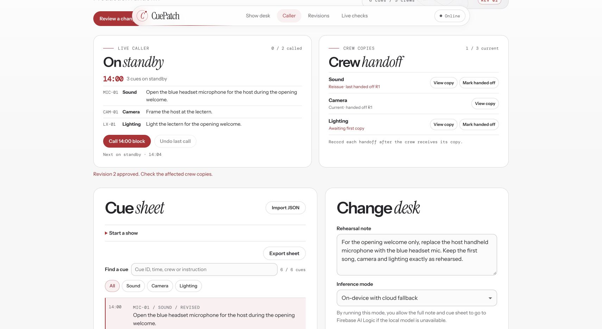

# CuePatch

A stage manager turns one last-minute rehearsal change into reviewed revisions for sound, lighting, camera and stage. Each suggestion names a cue, shows its old and new instructions and quotes the rehearsal note. The caller decides which edits to release. Each crew can export its own calling copy.

[Open CuePatch on Vercel](https://cuepatch-iota.vercel.app/) · [Run a live Firebase check](https://cuepatch-iota.vercel.app/checks.html) · [Download the Android APK](https://github.com/johnbosco-j/CuePatch/releases/download/android-v1.0.0/CuePatch-1.0.0.apk) · [Android setup](android/README.md)



## Use the show desk

Open the show desk on your phone or computer. On Android 8 or later, you can also install the signed APK. The installed desk opens offline and saves each production on that device. Choose **Start a show**, enter the production name and paste spreadsheet rows with four columns (ID, time in HH:MM, crew and instruction). Tab-separated or vertical-bar-separated lines are supported. Alternatively import an existing rundown JSON, or use the included eight-cue campus showcase. The desk accepts 1–60 cues.

Enter a rehearsal change. For a supported, prepared Chrome device, choose **On-device only**. In Brave and other online browsers without the local model, choose **On-device with cloud fallback** to allow Firebase to process the sheet. Click **Find affected cues**. Review each proposed edit against its highlighted quote and select only the changes to issue. **Approve selected cues** creates a revision. Filter by crew, choose **Export sheet** to inspect that department’s calling copy and **Download text file** to save it.

The example-note button fills the note field. Every proposal requires a successful Firebase response. The dashboard saves productions in this browser profile. **Saved production** switches shows. **Download rundown JSON** exports the row list for spreadsheets or another CuePatch desk. **Back up production** includes call progress, crew handoffs, saved notes and revision details. Importing a backup creates a separate production. Cue IDs, times and crew assignments remain fixed when approving generated instruction changes.

## Run a show

- **Live caller** groups consecutive cues with the same time, including shows that cross midnight. Call a block to move every department in that block onto the next one. Undo returns the last block to standby.
- **Open caller view** enlarges the current and following blocks and lists the scheduled time alongside the actual call time in a production log. The caller can advance or undo from either view. Escape or **Back to desk** returns to the dashboard.
- **Cue timeline** opens a time block in the sheet. Filter by crew or search by cue ID, clock time or instruction. Crew exports always include the entire selected department.
- **Crew handoff** records the caller’s acknowledgement after a crew receives its copy. View, print or download a sheet, then mark it handed off. Approving changes puts only the affected departments back into the reissue list.
- **Open mobile copy** creates a read-only, revision-specific crew sheet that the operator can open on a phone. The handoff board identifies revised cue IDs. Crew copies can show just the rows revised since the previous recorded handoff. A link includes this department’s current instructions in its URL fragment and anyone with the full link can read them. Later changes require a new link. **Download offline HTML** produces a standalone sheet with the same cues and works for long rundowns too. Opening a link does not mark a handoff.
- **Edit** beside any cue makes a manual correction without a model. Saving records the before/after wording with the source **Caller edit** and marks the affected issued copy for reissue.
- **Saved rehearsal notes** lets the caller explicitly retain up to 20 reusable notes per production. **Revision log** shows the accepted before/after instructions and approval time for new revisions. Older desk data keeps its original available history.
- **Offline desk ready** means the local interface has been downloaded. After one successful preparation, opening the desk, calling cues, managing handoffs and exporting sheets work when the application server is unreachable. New AI requests on an offline device require a separately prepared, supported local model.

## How earlier winners informed the dashboard

Google awarded Trail best hybrid web app in its 2025 Chrome challenge. Its offline trip preparation informed the cached venue desk. Orma’s workspaces and retrieval informed named productions and inspectable revisions. Opale’s reusable prompts informed the caller’s opt-in note shelf. These are original implementations for stage crews. [2025 official results](https://developer.chrome.com/blog/ai-challenge-winners-2025) · [Prior official results](https://developer.chrome.com/blog/ai-challenge-winners) · [Trail](https://devpost.com/software/trail-2ia5xw) · [Orma](https://devpost.com/software/orma) · [Opale](https://devpost.com/software/opale)

## Observed on November 21, 2026

Live requests from Brave used the dedicated project with App Check. Moving the opening host to the lectern returned precisely the four opening cues in 2.88 seconds. A new camera note about the first song returned VC-02 alone in 2.1 seconds. The caller approved that edit as revision 2. Brave reported the on-device model unavailable in local-only mode. The redesigned app also returned all four opening edits in 2.5 seconds, VC-02 alone in 2.35 seconds, and no edits for an unchanged rehearsal. With a local preview server subsequently stopped, Brave reopened the cached desk, called the 18:00 block, recorded a Lighting handoff and opened its two-cue calling copy. In a separate six-cue production, a cloud request returned only MIC-01 in 1.9 seconds. After approval, Sound needed a new copy, Camera retained its current copy and the singer’s microphone stayed unchanged. A manual correction was also saved on a prepared desk after the preview server stopped. Successful local-model inference on supported Chrome still needs hardware verification.

## Interface

CuePatch adapts the entrant’s pre-existing Riven design reference to a stage caller’s desk. The white and gray surfaces use a single red accent. Instrument Sans and italic Instrument Serif carry the heading hierarchy, with DM Mono for cue IDs, times and revisions. The capsule navigation, orbital overview, grouped crew filters, keyboard controls and reduced-motion layout were implemented for this entry. The orbit uses browser CSS. No company photos or 3D assets ship with the app.

## Run the Firebase version

1. Use a dedicated Firebase project. In Firebase Console enable **AI Logic** with the **Gemini Developer API**. Register a web app. Register the same web app in App Check with a **reCAPTCHA Enterprise** web key for your demo domain. Confirm that enforcement for Firebase AI Logic is active.
2. From this directory copy `web/config.js` to `config.local.js`. Fill `firebase` with the demo app's browser configuration from Project Settings and `appCheckSiteKey` with the public Enterprise site key. These values are delivered to the browser. Keep their source file outside version control. Never enter a Gemini API key, service-account credential, reCAPTCHA secret or App Check debug token in those fields.
3. For localhost only, set `localDebug: true`. Register the browser-generated debug token privately in the Firebase console as described in the official guide. Use `localDebug: false` with the registered live domain.
4. Build and serve. Python 3 is required for these commands. The app loads Firebase JS SDK 13.4.0 from Google's CDN when configured. A first online load is required.

```sh
python3 build.py
python3 -m http.server 8080 --directory dist
```

5. Open http://localhost:8080 in desktop Chrome. Follow the Firebase Web guide and event FAQ to enable the supported built-in model for your Chrome channel. Allow the initial model download to complete online. Enter a rehearsal change and select **Find affected cues**.
6. For the on-device rehearsal, initialise the model and complete a live local run while online first. Leave the tab open, take the browser offline and try a different note. The saved desk can reopen offline. Restarting AI offline also depends on availability of the SDK and local model on that client. For the fallback test use a second online Chrome profile/device without a usable local model, choose **On-device with cloud fallback**, and run the same note. Record the actual source returned by the SDK. Network status at the top describes browser connectivity only.
7. For hosting, build with the production demo configuration, then use the authenticated Firebase CLI command below. Replace PROJECT_ID with the dedicated project ID. Verify App Check and the live URL in a clean judging browser. Keep hosting and model access available through December 16 PT.

```sh
firebase deploy --only hosting --project PROJECT_ID
```

## Measure a live rehearsal

Choose **Test live Firebase inference** in the show desk footer. Each click
runs one new Firebase request against the same eight fictional cues. Select
one of four cases and a routing mode. The results show the SDK source, elapsed
seconds, missed cue IDs, extra cue IDs and the proposed wording. Download the
JSON before closing the page. Failed requests appear as failures. To evaluate an offline run, open and
prepare the checks page while online, then disconnect with that tab open.

## Where inference happens

`web/ai.js` dynamically imports Firebase App, App Check and AI Logic. It initializes App Check, calls `getAI` and creates separate `ONLY_ON_DEVICE` and `PREFER_ON_DEVICE` models. The button handler initializes the device model during a user gesture and calls `generateContent`. Both routes use Firebase AI Logic. The fallback option sends the full change note and cue list to the cloud when the SDK selects cloud execution. The default mode is local only. Use fictional or authorised, non-confidential data for judging.

The UI reads `response.inferenceSource` from each completed request and measures elapsed time including model preparation. Invalid JSON, invented evidence, unknown IDs and repeated IDs stop the revision. An exact quote establishes a source for review. A person still checks whether the proposed instruction is justified and whether the model missed another cue.

The browser stores each production locally, including approved instructions, call progress, handoff records and before/after revision history. Unapproved AI suggestions and raw notes stay in page memory unless the caller explicitly saves a reusable note. Production backups include those saved notes. This is a single-caller device workspace. Handoff records are manual acknowledgements. Separate tabs use per-show write locks and version checks. Cloud fallback sends the cue rows and current note to Firebase only when selected.

## Tests

```sh
node --test tests/*.test.cjs
```

Tests cover cue validation, partial approval and review state. These run with Node 20+ and no package installation. Real device inference, cloud fallback, enforcement and venue usability require the live acceptance checks in SUBMISSION.md.

## Project provenance

New project started November 20, 2026 for #BuildHybridAI. Original application code and fictional rehearsal material were created during the event with Codex assistance. The Firebase SDK and its dependencies retain their respective licenses. The application source uses the MIT license. The Riven design system supplied the visual reference. All CuePatch application logic, stage instructions and interface implementation were created for this event.

## References

- [Official rules](https://firebasehybridaihackathon.devpost.com/rules) and [event FAQ](https://firebasehybridaihackathon.devpost.com/details/faqs)
- [Firebase hybrid Web setup](https://firebase.google.com/docs/ai-logic/hybrid/web/get-started) and [source reporting](https://firebase.google.com/docs/ai-logic/hybrid/web/configuration-options)
- [Firebase App Check for Web](https://firebase.google.com/docs/app-check/web/recaptcha-enterprise-provider)
- [Central Connecticut State University stage management handbook](https://www.ccsu.edu/sites/default/files/2025-08/Updated%20SM%20and%20ASM%20Handbook%202025%20mf.pdf) for the prompt-book and cue-coordination workflow. Its production materials are not distributed with CuePatch.
