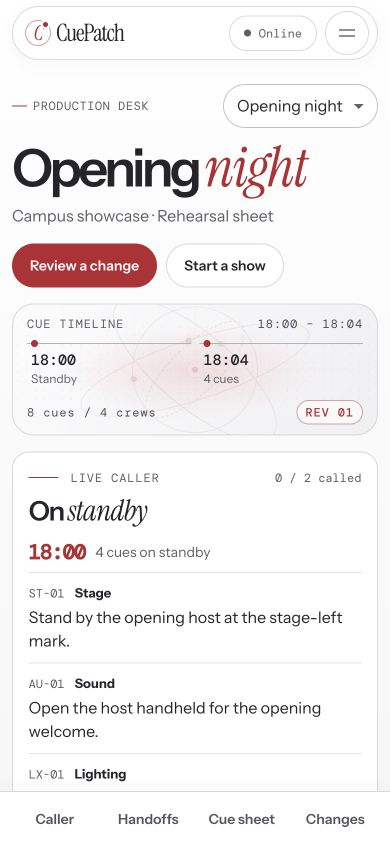
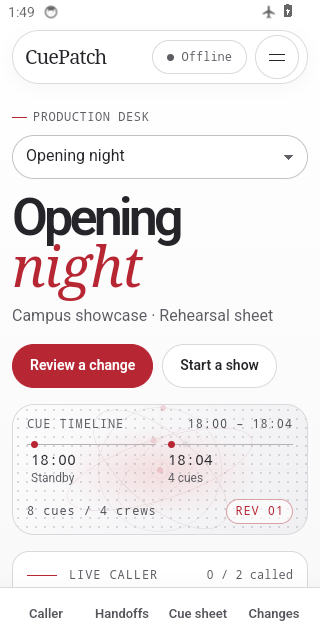

# CuePatch for Android

The APK installs the CuePatch show desk, production library, caller view and crew exports on the device. The desk loads from bundled assets and uses Android System WebView for rendering. It can run the show without loading a website. The Kotlin application owns Firebase inference, file selection, exports, Android Sharesheet and printing. No account is required to call a show or manage its cues.

The mobile desk puts Caller, Handoffs, Cue sheet and Changes within thumb reach. Open the navigation menu on the web desk to download the signed APK.

 

## Build

1. Install JDK 17 and Android SDK Platform 36. Use the included Gradle wrapper from this directory.
2. Register the app ID `app.riven.cuepatch` in your Firebase project and download its Android client `google-services.json` into `app/`. Enable Firebase AI Logic with the Gemini Developer API.
3. For development run `./gradlew assembleDebug`. Register the installation’s private App Check debug token through Firebase Console for cloud inference. Keep the token off GitHub.
4. For distribution create an Android reCAPTCHA Enterprise key restricted to your package, enable support for applications distributed outside Google Play, register it for this Android app in Firebase App Check, and save its public site key in a one-line `recaptcha-site-key.txt` (or set `CUEPATCH_ANDROID_RECAPTCHA_SITE_KEY`). Run `./gradlew assembleRelease` and sign the resulting unsigned APK with the same release key on subsequent updates. The repository excludes the key and Android client configuration.
5. Install on Android 8.0 (API 26) or later with a current Android System WebView. The Gemini Nano path requires an Android device supported by the Firebase on-device SDK and a prepared local model.

## Verify on a device

Tap **Check on-device model** from the inference control. If Android offers a download, complete it on Wi-Fi before the rehearsal. Open **Live checks**, select a rehearsal case and choose **On-device only**. Run a request on a supported device with the required model available. Inspect the SDK source and cue IDs. Then use a device without the local model, enable cloud fallback in the app, and repeat online. The Android test-report export records the observed source for each completed request. A local-only failure keeps cloud execution disabled.

Import a production via the system picker. Call one block, close and reopen the app, and confirm that progress was restored. Issue a crew copy and share its revision link with another phone, or save a portable HTML file and open it offline. The native print action opens Android’s print UI. Browser and Android storage are separate; exchange a production backup to move a show between them.

### Repeat the signed-release test

Build the separate instrumentation APK with `./gradlew :app:assembleReleaseAndroidTest`. Sign it with the same certificate as the release you are testing. In Firebase Test Lab, choose **Instrumentation**, upload the published app APK and the signed test APK, and select a physical Android phone. The test opens **Live checks**, chooses **Swap the opening microphone**, enables cloud fallback, and checks that the SDK reports an inference source and that only AU-01 changes. The device log records the source and elapsed time under `CuePatchReleaseTest`. To require local execution on a prepared device, supply the instrumentation argument `route=private`.

[Android hybrid inference](https://firebase.google.com/docs/ai-logic/hybrid/android/get-started) · [Android reCAPTCHA Enterprise App Check](https://firebase.google.com/docs/app-check/android/recaptcha-enterprise-provider) · [App Check debug provider](https://firebase.google.com/docs/app-check/android/debug-provider)
